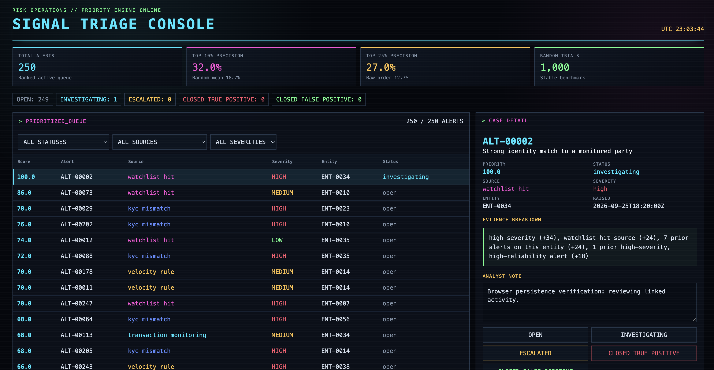

# Alert Triage Prioritizer

Alert Triage Prioritizer is a local case-management application that ranks a queue of synthetic, multi-source fraud and risk alerts by an explainable priority score. It combines transaction monitoring, Know Your Customer (KYC) mismatch, velocity-rule, and watchlist-hit alerts in one review queue, then lets an analyst investigate cases and persist their status and notes across sessions.

The tool is intended as a portfolio demonstration for risk operations, fraud investigation, and trust and safety roles. It uses synthetic data only and is not a production decision system or a validated fraud model.

## Screenshot



## Install and run

Python 3.11 or later is recommended.

Create and activate a virtual environment:

```bash
python3 -m venv .venv
source .venv/bin/activate
```

Install the existing project dependencies:

```bash
pip install -r requirements.txt
```

Regenerate the seeded synthetic alerts:

```bash
python scripts/generate_alerts.py
```

Start the dashboard and application programming interface (API):

```bash
uvicorn app.main:app --reload
```

If the `uvicorn` command is not available on your system path, use:

```bash
python -m uvicorn app.main:app --reload
```

Open [http://127.0.0.1:8000](http://127.0.0.1:8000).

## How prioritization works

Each alert receives a composite priority score from 0 to 100 based on three signals available to an analyst at review time:

- Alert severity, with higher-severity alerts receiving more weight.
- Source reliability, using the scoring engine's own calibrated assumptions rather than the generator's hidden ground-truth reliability values.
- Entity alert-history context, including the number of alerts previously raised for the entity and whether that history contains a high-severity alert from a higher-reliability source.

The scorer does not use the synthetic entity `risk_history_score` field. It derives risk context from prior alert patterns in the queue itself, avoiding access to information a real scoring engine would not have.

Every score includes a plain-English evidence breakdown, such as `high severity (+34), watchlist hit source (+24), 4 prior alerts on this entity (+16)`. This keeps each ranking inspectable instead of presenting an unexplained score, following the same explainability standard as the other tools in this portfolio.

## Why prioritization matters

True positives make up 18.4% of the synthetic alert queue. In the validated top-10% comparison:

| Queue ordering | Precision in top 10% |
| --- | ---: |
| Prioritized | 32.0% |
| Random ordering, mean of 1,000 shuffles | 18.7% |
| Raw arrival order | 8.0% |

Working the prioritized top 10% therefore produces a meaningfully stronger review set than naive first in, first out (FIFO) triage and outperforms the average random ordering in this generated dataset. The lift is useful but modest, not dramatic. These are non-inflated results from one seeded synthetic queue, not evidence of expected production performance.

## Case management

The dashboard supports persistent case states for every alert:

- `open`
- `investigating`
- `escalated`
- `closed_true_positive`
- `closed_false_positive`

Analysts can update a status and save an optional note without reloading the page. Case state is stored in `data/triage.db` using Python's built-in SQLite support, so it survives application restarts and browser sessions.

This is the first tool in the portfolio with real persistent state rather than a read-only analysis. The generated alert data can be reproduced, while analyst case decisions remain stored separately in the local database.

## Run the tests

```bash
pytest -q
```

The tests cover the dashboard, ranked queue, metrics endpoint, and persistence of a status update when the alert is fetched again.

## Data

All entities and alerts are fully synthetic. No real merchant, account, customer, watchlist, or investigation data is included.

`scripts/generate_alerts.py` uses fixed seeds and reproducibly creates the entity and alert datasets under `data/`. The generated queue includes repeat alerts, noisy source signals, and both true and false positives across severity levels. Generator ground truth, including the source reliability values and overall true-positive rate, is documented in [`data/manifest.json`](data/manifest.json) for evaluation only.

## Limitations

- Scoring weights are illustrative and have not been calibrated on real alert outcomes.
- Synthetic source behavior and entity histories simplify real operational and data-quality complexity.
- Priority scores rank review order but do not establish that an alert is fraudulent or justify an automated action.
- Top-k results come from one reproducible synthetic dataset and do not establish real-world precision.
- The application is a local demonstration, not a production case-management or fraud-decision system.
